# Logpile — Best Free Offline PC Game Launcher & Library Manager (Playnite Alternative)
> **The lightweight, open-source PC game launcher, library manager, and game saver for Windows. Built as an offline alternative to Playnite and GOG Galaxy. Unify games across Steam, Epic, GOG, and portable SSDs with automatic save backups, HowLongToBeat backlog tracking, 50+ custom HUD overlays, and zero cloud tracking.**

[](https://github.com/ritesh-soni-logpile/logpile/releases/latest)
[](https://github.com/ritesh-soni-logpile/logpile/releases/latest)
[](LICENSE)
[](#)
[](https://logpilegamelauncher.netlify.app)
[](https://logpile.itch.io/logpile)
[](https://alternativeto.net/software/logpile-desktop/about/)

<p align="center">
  <a href="https://github.com/ritesh-soni-logpile/logpile/releases/download/v1.3.96/Logpile.Setup.1.3.96.exe">
    
  </a>
  &nbsp;&nbsp;
  <a href="https://github.com/ritesh-soni-logpile/logpile/releases/download/v1.3.96/Logpile-1.3.96-win.zip">
    
  </a>
</p>

<!-- Hero Demonstration -->
<p align="center">
  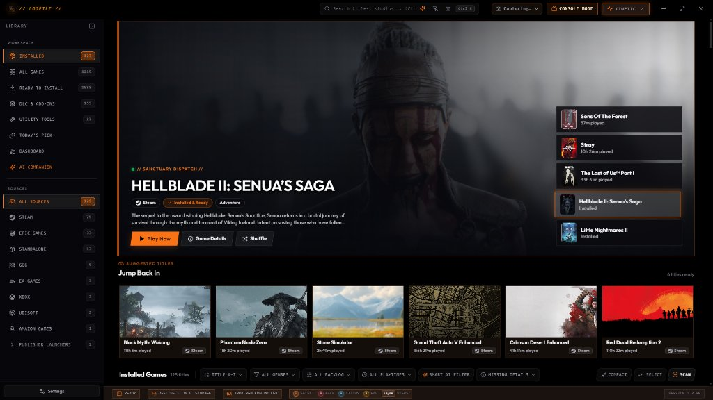
</p>

## Why Gamers Choose Logpile (Playnite & GOG Galaxy Alternative)
Most PC game launchers and library managers are storefronts first. They run heavy web browsers in the background, demand account logins just to view games on your own drives, and break when Windows shifts an external SSD from `D:` to `E:`. They also leave you guessing whether a shared Steam Family title is actually free to play before you launch it.

Logpile is built for gamers who want the best offline PC game launcher, library manager, and game saver:
- **Playnite & GOG Galaxy Alternative:** Discovers and launches your games directly from disk without store logins, third-party sync plugins, or memory bloat.
- **22+ Storefronts & Custom Folders:** Deep scanning across Steam, Epic Games (v1 + v2), GOG, Xbox / Game Pass, EA App, Ubisoft Connect, Amazon Games, Battle.net, Riot, itch.io, Netmarble, LoadingBay, HoYoPlay, and portable SSD game directories.
- **Duplicate Installs Advisor:** Detects multi-store duplicates (e.g. Steam + Epic + Game Pass copies), advises which to keep, and shows reclaimable disk space.
- **Automated Game Saver:** Automatically monitors local game save folders and creates rolling timestamped ZIP backups before every session.
- **Portable SSD Path Healing:** Uses `{{PORTABLE_ROOT}}` variables to self-heal broken game paths when drive letters change.
- **50+ Themed Performance HUDs:** Custom in-game FPS and hardware telemetry overlays powered by Intel PresentMon that pull 0.0% idle GPU power when minimized.
- **HowLongToBeat Backlog Tracker:** Built-in Excel and CSV backlog import with campaign debt calculation.
- **100% Offline & Private:** Open-source MIT license, zero network telemetry, and zero background services.

---

## How Logpile Compares

<p align="center">
  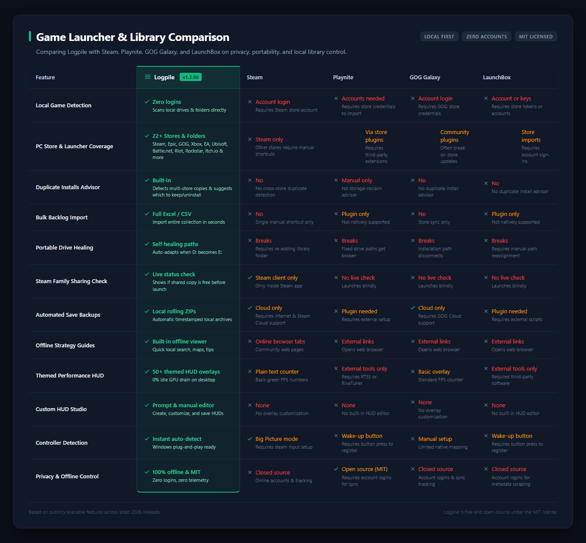
</p>

<details>
<summary><strong>View comparison table as text</strong></summary>

| Feature | Logpile v1.3.96 | Steam | Playnite | GOG Galaxy | LaunchBox |
| :--- | :--- | :--- | :--- | :--- | :--- |
| **Local Game Detection** | **Zero logins:** Scans drives & folders directly | Store account login required | Account logins required for library sync | GOG account login required | Account logins or store tokens required |
| **PC Store & Launcher Coverage** | **22+ Stores & Custom Folders:** Steam, Epic, GOG, Xbox, EA, Ubisoft, Amazon, Itch.io, Battle.net, Riot, Rockstar, CDPR, Humble, HoYoPlay, Legacy, Wargaming & more | Steam only | Via store plugins | Via community integrations | Via store imports |
| **Duplicate Installs Advisor** | **Built-in:** Detects multi-store installs, suggests which to keep/uninstall & shows reclaimable GB | No | Manual / no advisor | No | No |
| **Bulk Backlog Import** | **Built-in:** Import entire uninstalled library via Excel / CSV | No (Single manual shortcut only) | Plugin required | No | Plugin required |
| **Portable Drive Path Healing** | **Built-in:** Auto-adapts when drive letters change (`D:` to `E:`) | Breaks on drive letter change | Breaks on drive letter change | Breaks on drive letter change | Breaks on drive letter change |
| **Live Steam Family Status** | **Yes:** Checks if shared game is free to play before launch | In-app store client only | No live check | No live check | No live check |
| **Automated Save Backups** | **Built-in:** Automatic rolling local ZIP archives | Cloud only (for supported games) | Plugin required (e.g. Ludusavi) | Cloud only (for supported games) | Plugin required |
| **Offline Strategy Guides** | **Built-in:** Offline guide, map & tip viewer | Community web browser tabs only | External browser links only | External browser links only | External browser links only |
| **Themed Performance HUD** | **50+ Custom Styles:** Themed in-game overlays (0% idle GPU) | Basic plain text FPS counter | Third-party tools needed (RTSS) | Basic plain text FPS counter | Third-party tools needed |
| **Theme Studio & Custom CSS** | **Built-in:** Live CSS injector, natural language synthesis, 8 community themes | No | Third-party skin plugins | No | Themes via community themes |
| **Full Page & 4K Brag Snaps** | **Built-in:** Continuous vertical settings capture & 4K UHD gallery posters | Basic desktop screenshot | Screenshot plugins | Basic screenshot | Basic screenshot |
| **Big Picture Console Mode** | **5 Theme Worlds:** Distinct 10-foot UIs, Couch OSK, Adaptive Glyphs & Voice AI | One fixed layout | Fullscreen mode (theme-dependent) | No | Paid Big Box mode |
| **Controller Auto-Detect** | **Yes:** Instant Windows plug-and-play detection | Big Picture mode or manual setup | Wake-up button press required | Manual setup / limited | Wake-up button press required |
| **Privacy & Offline First** | **100% Offline:** MIT open source, zero logins, zero tracking | Closed source, store accounts & tracking | Open source, relies on store logins | Closed source, accounts & telemetry | Closed source, logins for metadata |

</details>

---

## Visual Showcase & Key Features

### 1. Big Picture Console Mode: 5 Distinct Theme Worlds
Press `F11`, `Ctrl+Shift+F`, or click **Console Mode** in the top bar to switch into an authentic 10-foot couch interface. Logpile features five distinct theme worlds, full controller navigation with auto-detected Xbox, PlayStation, and Nintendo Switch glyphs, an on-screen virtual keyboard (OSK), and voice-assisted backlog prompts.

<p align="center">
  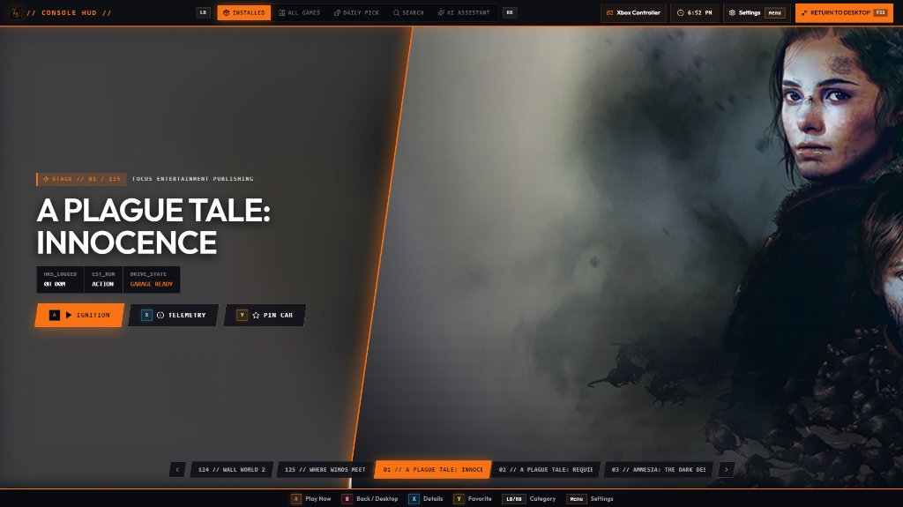
  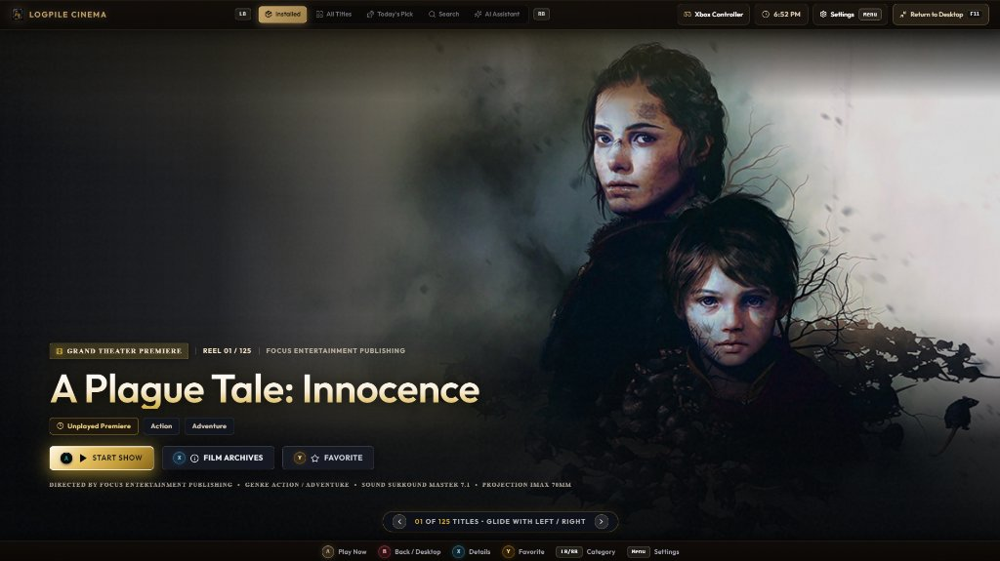
</p>
<p align="center">
  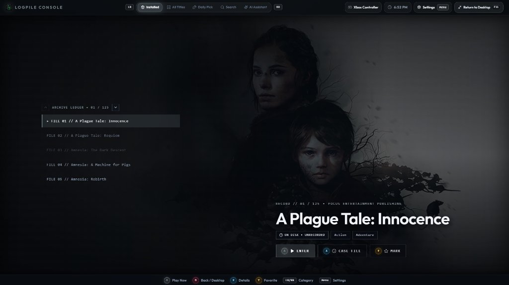
  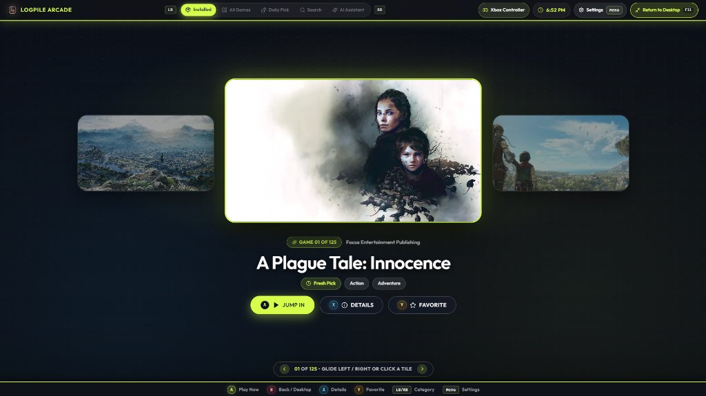
  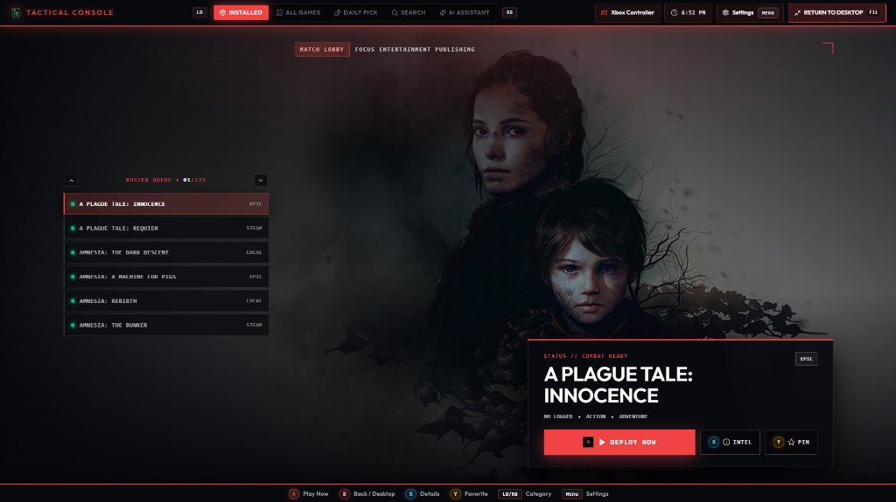
</p>

- **Kinetic:** Dark asphalt motorsport telemetry strip (`HRS_LOGGED`, `EST_RUN`, `DRIVE_STATE`), 5-slot slanted Track Strip, and Starting-Grid Gantry.
- **Cinematic:** Full-bleed IMAX screening room with marquee styling, bottom title counter, and a centered Today's Pick reel.
- **Atmospheric:** Survival-horror save-room view with mist effects, 5-row sliding vertical Case Ledger, and Analog Signal Receiver.
- **Playful:** 3-slot wrap-around 16:9 landscape tile carousel with Surprise Capsule Daily Pick.
- **Competitive:** 3-zone tactical match lobby with storefront status LEDs, corner-reticle showcase, and Matchmaking Queue Scanner.

---

### 2. Dynamic Game Dossier & Save Sentinel
Selecting any game opens its dedicated Dossier stage, adapting color and styling to your active sanctuary theme.

<p align="center">
  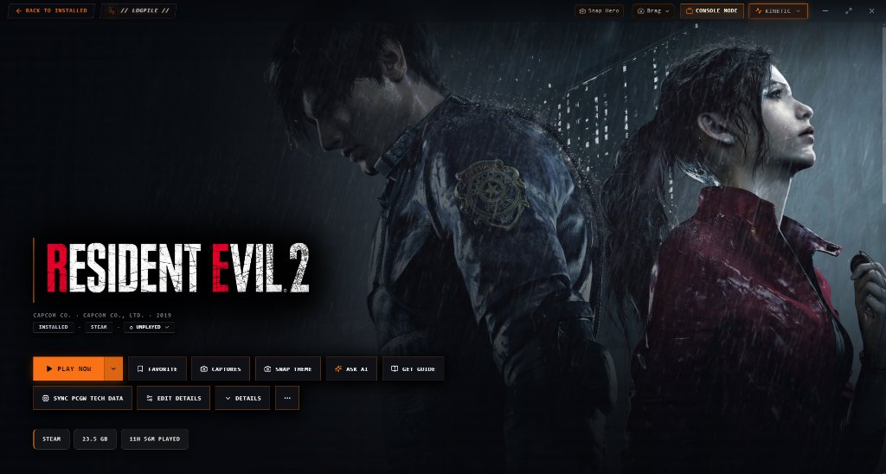
  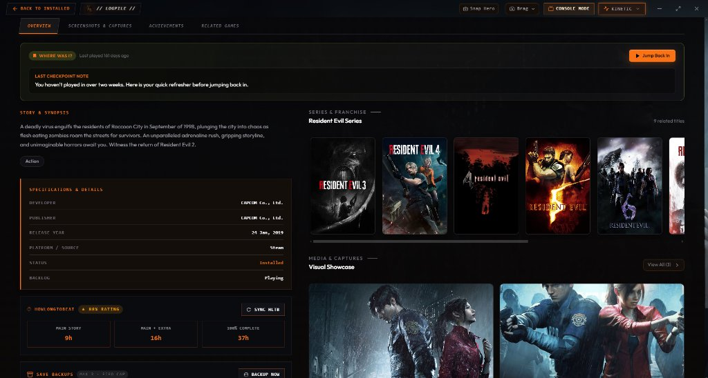
</p>

- **Specs & Details:** Developer, publisher, release date, platform tags, and HowLongToBeat completion times.
- **Series & Franchise Matcher:** Intelligently groups and displays all owned titles across the same franchise.
- **Automated Rolling Save Backups:** Real-time directory monitoring with rolling timestamped ZIP archives before and after game sessions.
- **Launch Arguments & Mod Profiles:** Custom launch directives and flags persisted per title (e.g. `-dx11 -novid`).

---

### 3. Sanctuary Analytics & Duplicate Installs Advisor
Manage your library storage and gain deep visibility into your backlog distribution across stores and drives.

<p align="center">
  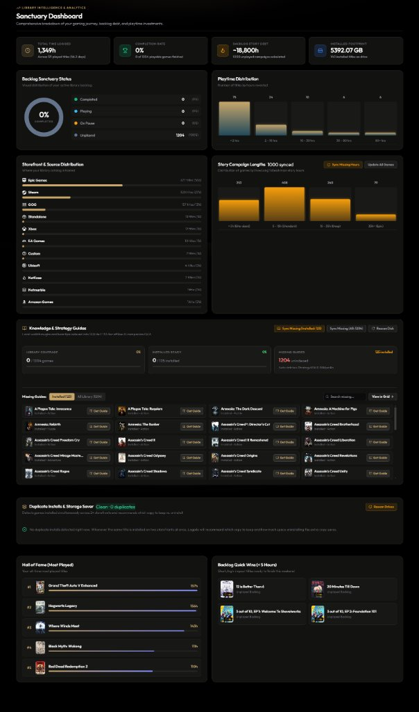
</p>

- **Duplicate Installs & Storage Saver:** Highlights titles installed on multiple stores (e.g., Steam + Epic Games), recommends which edition to keep based on save compatibility and playtime, and displays reclaimable gigabytes.
- **Backlog Campaign Debt:** Automatic HowLongToBeat campaign time calculations against your unplayed titles.

---

### 4. 50+ Themed Performance HUD Overlays
Logpile includes over 50 custom in-game telemetry HUDs powered by Intel PresentMon (DirectX 11/12 & Vulkan). Zero DLL injection, true 1% lows, frame time velocity, and 0.0% idle GPU usage.

<p align="center">
  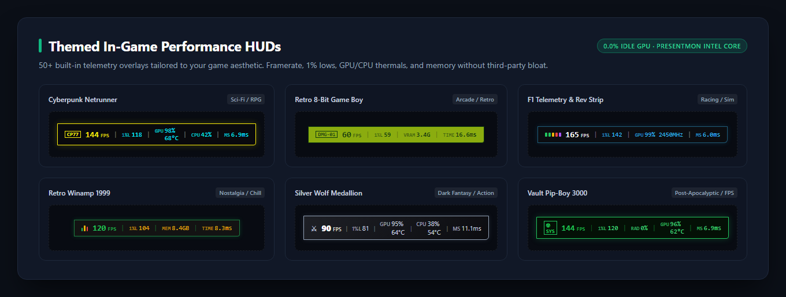
</p>

- **Themed Aesthetic Overlays:** Cyberpunk Netrunner, 8-Bit GameBoy, F1 Motorsport Telemetry, Retro Winamp 1999, Silver Wolf Medallion, Vault Pip-Boy 3000, and more.
- **Custom HUD Theme Studio:** Dial in colors, font families, and telemetry gauges manually or generate styles from text prompts using offline presets.

---

### 5. 4K Ultra-Wide Brag Showcase Collage Engine
Export your game sanctuary into balanced high-resolution gallery posters across multiple sanctuary themes, accent palettes, and aspect ratios (Full Grid, 16:9, 9:16, 1:1) in a single click with automatic clipboard copy.

<p align="center">
  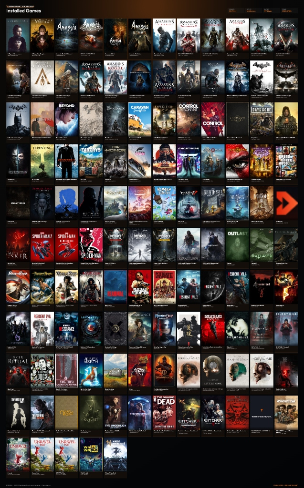
  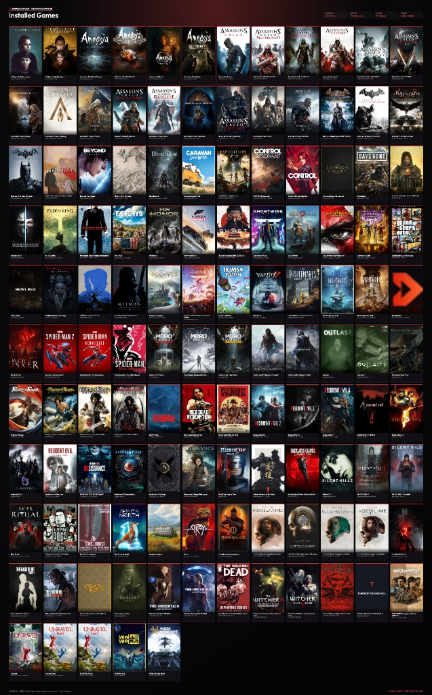
  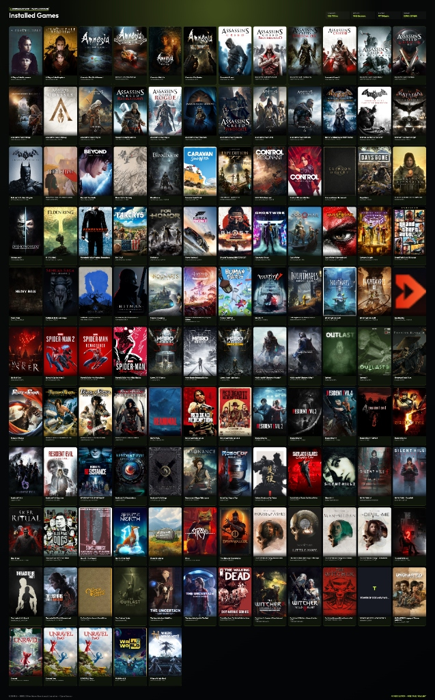
  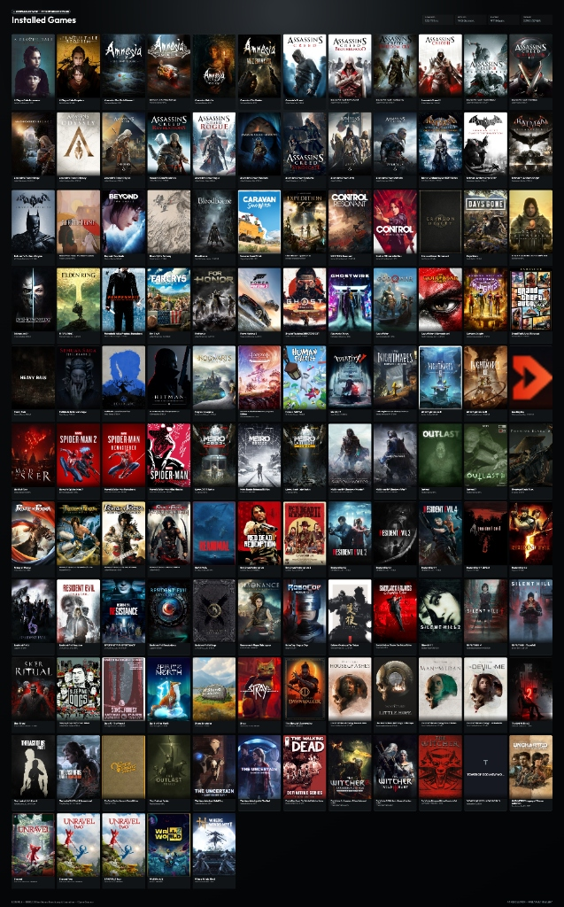
</p>

- **Dynamic Aspect Ratios & Title Wrapping:** Dynamic column scaling, high-DPI aspect-fill cover rendering, and multi-line title wrapping to prevent name clipping.
- **Whole-Page Continuous Stitching:** Capture complete scrollable pages—including full library grids, game dossiers, and settings—into single seamless vertical images.

---

## What's New in v1.3.96

### Epic Games v2 Migration, Native Netmarble & LoadingBay Scanners
- **Epic Games Dual-Engine (v1 + v2):** Seamlessly detects games from both legacy Epic manifests (`C:\ProgramData\Epic\EpicGamesLauncher\Data\Manifests\*.item`) and modern Epic v2 installations (`%LOCALAPPDATA%\com.epicgames.eglv2\installations.jsonl`), ensuring zero lost games during launcher updates.
- **Native Netmarble Launcher Scanner:** Directly reads Netmarble's launcher configuration (`%APPDATA%\Netmarble Launcher\config.json`) and Windows uninstall entries to discover titles like *Tower of God: NEW WORLD* and *Game of Thrones: Kingsroad*, preserving custom install paths and cover artwork.
- **Native NetEase / LoadingBay Scanner:** Deep registry indexing for LoadingBay games (`HKCU\SOFTWARE\LoadingBay\LoadingBayInstaller\game\*`) such as *Identity V* and *Once Human* with native `loadingbay://` launch URI execution.
- **Exclusion Filter Hardening:** Ignores launcher binaries (`LoadingBay.exe`, `Rockstar Games SDK`, background redistributables) so only real playable games enter the library.
- **Storefront Filter Isolation in Installed View:** Selecting a storefront filter (Steam, Epic, GOG, etc.) in the **Installed** workspace view strictly filters to copies installed on that specific storefront.
- **EA Title Cleaner:** Automatic normalization for EA titles with corrupted trademark characters (e.g. `UNRAVELT two` -> `Unravel Two`).
- **Franchise Stem Matcher Fix:** Resolved ReferenceError in franchise stem extraction during Game Dossier navigation.

👉 **[View Full Version History & Changelog (v1.3.5 - v1.3.96)](CHANGELOG.md)**

---

## Architecture & Tech Stack
- **Shell:** Electron 34 with strict `contextIsolation: true`, zero raw IPC leaks, and sandbox-isolated window navigation.
- **Frontend:** React 18, Vite, Tailwind CSS, virtualized catalog grid, and native 60fps Gamepad API polling that auto-pauses during gameplay.
- **In-Game Telemetry:** Integrated Intel PresentMon (MIT License) for real-time DirectX 11/12 and Vulkan frame time velocity, true 1% lows, GPU/VRAM load, and hardware engine bottleneck detection without game DLL injection.
- **Local Database:** SQLite with FTS5 full-text indexing via `better-sqlite3`.
- **Offline Intelligence:** Embedded `node-llama-cpp` for local quantized GGUF inference + offline speech recognition (STT) and Windows native SAPI (TTS).

---

## Quickstart

### For Gamers
1. Grab the latest installer or portable archive from [Releases](https://github.com/ritesh-soni-logpile/logpile/releases/latest):
   - **Installer:** [`Logpile.Setup.1.3.96.exe`](https://github.com/ritesh-soni-logpile/logpile/releases/download/v1.3.96/Logpile.Setup.1.3.96.exe)
   - **Portable (.zip):** [`Logpile-1.3.96-win.zip`](https://github.com/ritesh-soni-logpile/logpile/releases/download/v1.3.96/Logpile-1.3.96-win.zip)
2. Extract or install to any internal drive or portable SSD (`logpile_data/` stores all assets self-contained).
3. *(Optional)* Drop any quantized `.gguf` model into the `/models` directory to enable offline conversational backlog guidance.

#### Recommended Offline AI Models (Optional)
Logpile runs local GGUF models via `node-llama-cpp` for conversational backlog guidance, custom HUD/CSS theme synthesis, and offline chat. Download any `.gguf` file and drop it into your `/models` folder.

| System / VRAM | Best Pick | Quant File | Approx. Size |
| :--- | :--- | :--- | :--- |
| **CPU Only (8-16 GB RAM)** | [Qwen3.5-2B EmperoAI Distill](https://huggingface.co/mradermacher/Qwen3.5-2B-EmperoAI-Qwen3.8-Distill-Heretic-Abliterated-i1-GGUF) | `Q4_K_M` or `Q5_K_M` | 1.1 - 1.4 GB |
| **CPU Only (32 GB+ RAM)** | [Qwen3.5-4B EmperoAI Distill](https://huggingface.co/mradermacher/Qwen3.5-4B-EmperoAI-Qwen3.8-Distill-Heretic-Abliterated-i1-GGUF) | `Q4_K_M` | ~2.7 GB |
| **4 GB VRAM** | [Qwen3.5-4B EmperoAI Distill](https://huggingface.co/mradermacher/Qwen3.5-4B-EmperoAI-Qwen3.8-Distill-Heretic-Abliterated-i1-GGUF) | `IQ4_XS` or `Q4_K_M` | 2.5 - 2.7 GB |
| **6 GB VRAM** | [Qwen3.5-4B EmperoAI Distill](https://huggingface.co/mradermacher/Qwen3.5-4B-EmperoAI-Qwen3.8-Distill-Heretic-Abliterated-i1-GGUF) | `Q6_K` or `Q8_0` | 3.5 - 4.5 GB |
| **8 GB VRAM** | [Qwen3.5-9B Heretic v2](https://huggingface.co/mradermacher/Qwen3.5-9B-heretic-v2-i1-GGUF) | `Q4_K_M` | ~5.5 GB |
| **12 GB VRAM** | [Qwen3.5-9B Heretic v2](https://huggingface.co/mradermacher/Qwen3.5-9B-heretic-v2-i1-GGUF) | `Q6_K` or `Q8_0` | 7.5 - 9.5 GB |
| **16 - 32 GB VRAM** | [Qwen3.5-9B Heretic v2](https://huggingface.co/mradermacher/Qwen3.5-9B-heretic-v2-i1-GGUF) | `Q8_0` or `F16` | 9.5 - 18 GB |

> **Hardware Guard Tip:** Enable automatic AI memory purge in Settings to clear loaded models from RAM/VRAM the moment a game launches.

<details>
<summary><strong>More Compatible Models (1.5B to 9B)</strong></summary>

- **1.5B - 2B (Ultra-Fast / Low RAM):** [Qwen3.5-2B Heretic GGUF](https://huggingface.co/tvall43/Qwen3.5-2B-heretic-gguf) · [Qwen2.5-1.5B Instruct Heretic](https://huggingface.co/saidutta69/Qwen2.5-1.5B-Instruct-heretic)
- **3B - 4B (Fast & Balanced):** [Gemma-4-E4B-it Heretic GGUF](https://huggingface.co/igorls/gemma-4-E4B-it-heretic-GGUF) · [Qwen3-4B Thinking Claude-4.5-Opus Distill](https://huggingface.co/mradermacher/Qwen3-4B-Thinking-2507-Claude-4.5-Opus-High-Reasoning-Distill-Heretic-Abliterated-i1-GGUF) · [Llama-3.2-3B Instruct Heretic](https://huggingface.co/DavidAU/Llama-3.2-3B-Instruct-heretic-ablitered-uncensored)
- **7B - 8B (Strong General & Reasoning):** [Qwen3-8B Hivemind Instruct Heretic](https://huggingface.co/DavidAU/Qwen3-8B-Hivemind-Instruct-Heretic-Abliterated-Uncensored-NEO-Imatrix-GGUF) · [DeepSeek-R1-0528 Qwen3-8B Heretic](https://huggingface.co/richardyoung/DeepSeek-R1-0528-Qwen3-8B-heretic-GGUF) · [Meta-Llama-3.1-8B Instruct Heretic](https://huggingface.co/saidutta69/Meta-Llama-3.1-8B-Instruct-heretic)
- **9B (Max Quality for 8 GB+ VRAM):** [DeepSeek-V4-Pro Qwen3.5-9B Heretic](https://huggingface.co/mradermacher/DeepSeek-V4-Pro-Qwen3.5-9B-UNCENSORED-heretic-i1-GGUF) · [Qwen3.5-9B The Defiant Fable Heretic](https://huggingface.co/DavidAU/Qwen3.5-9B-The-Defiant-Fable-Uncensored-Heretic-NEO-IMATRIX-MAX-MTP-GGUF)

</details>

*Note: Logpile is an independent open-source project and is not affiliated with, endorsed by, or sponsored by Hugging Face or any of the model creators listed above. All models are third-party community suggestions and remain subject to their respective licenses.*

### For Developers
```bash
git clone https://github.com/ritesh-soni-logpile/logpile.git
cd logpile
npm install
npm run electron:dev
```

---

## Author & License

Logpile is designed, architected, and tested by **Corporate Introvert Gamer (Ritesh Soni)**.

This project is licensed under the [MIT License](LICENSE).

```
Copyright (c) 2026 Corporate Introvert Gamer (Ritesh Soni)
```

### Third-Party Software & Acknowledgments
- **Intel PresentMon:** In-game graphics telemetry powered by Intel PresentMon (MIT License). Copyright (c) Intel Corporation.
- **HWiNFO:** Hardware sensor telemetry via HWiNFO's Shared Memory Support (when enabled by the user in HWiNFO).
