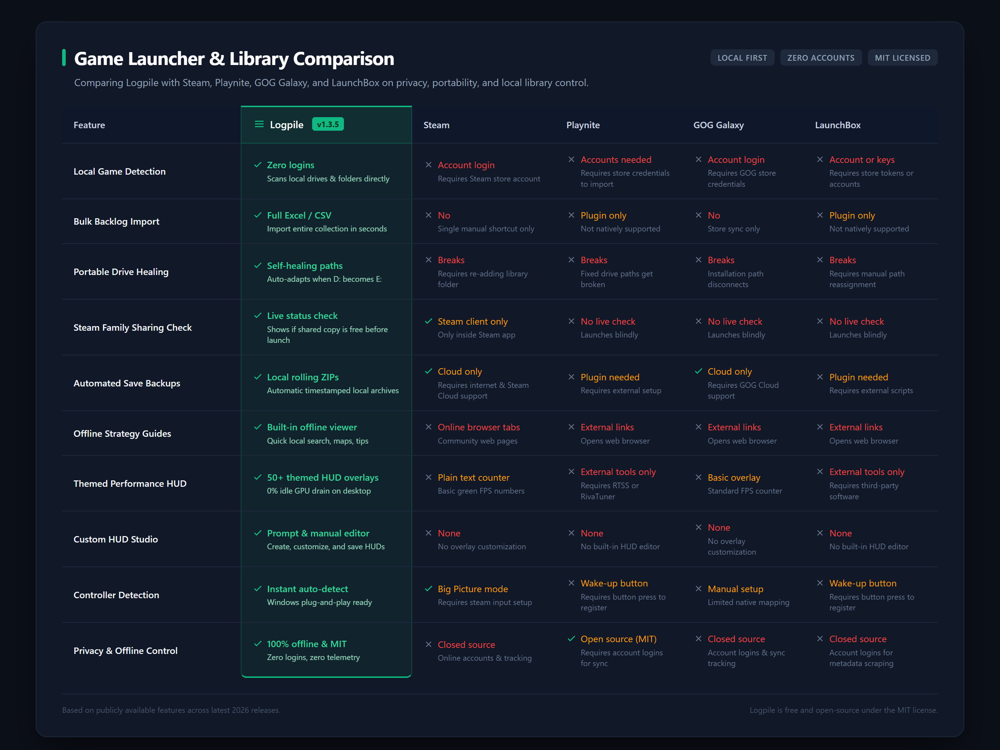
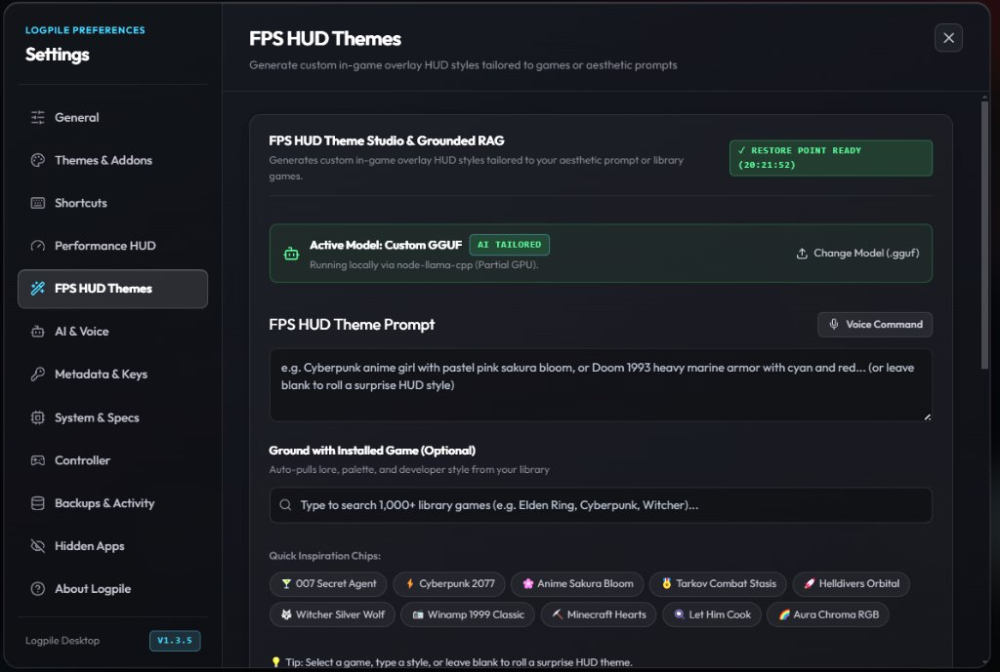
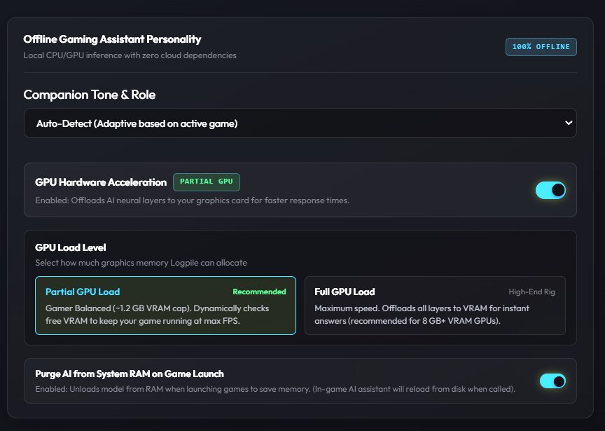
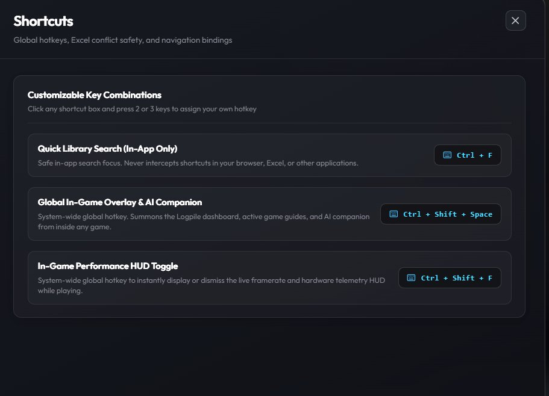
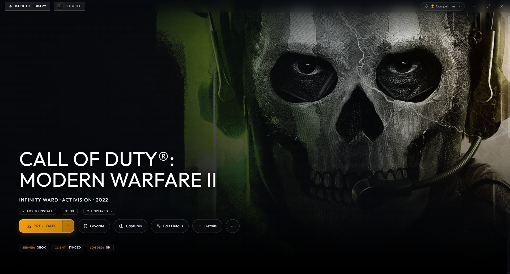
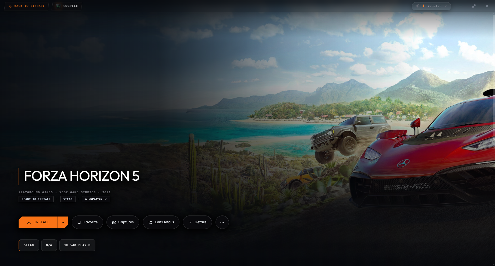

# Logpile
> **An offline-first, zero-bloat PC game library manager. Built for portable drives, powered by local AI, and completely disconnected from the cloud.**

[](../../releases/latest)
[](../../releases/latest)
[](LICENSE)
[](#)

<p align="center">
  <a href="https://github.com/ritesh-soni-logpile/logpile/releases/download/v1.3.5/Logpile.Setup.1.3.5.exe">
    
  </a>
  &nbsp;&nbsp;
  <a href="https://github.com/ritesh-soni-logpile/logpile/releases/download/v1.3.5/Logpile-v1.3.5-Portable.zip">
    
  </a>
</p>

<!-- Hero Demonstration -->
<p align="center">
  
</p>

## Why Logpile?
Most PC game launchers are storefronts first. They run heavy web browsers in the background, demand account logins just to view games on your own drives, and break when Windows shifts an external SSD from `D:` to `E:`. They also leave you guessing whether a shared Steam Family title is actually free to play before you launch it.

Logpile is built for gamers who want an offline-first library that manages local files properly. It stores everything—databases, artwork, and save backups—inside a single portable directory. It self-heals broken Windows drive paths automatically, checks live Steam Family availability before you launch, offers themed in-game performance overlays at 0% idle GPU load, and indexes strategy guides locally so you never have to Alt-Tab for help.

---

## At a Glance: Feature Comparison

<p align="center">
  
</p>

| Feature | Logpile v1.3.5 | Steam | Playnite | GOG Galaxy | LaunchBox |
| :--- | :--- | :--- | :--- | :--- | :--- |
| **Local Game Detection** | **Zero logins:** Scans drives & folders directly | Store account login required | Account logins required for library sync | GOG account login required | Account logins or store tokens required |
| **Bulk Backlog Import** | **Built-in:** Import entire uninstalled library via Excel / CSV | No (Single manual shortcut only) | Plugin required | No | Plugin required |
| **Portable Drive Path Healing** | **Built-in:** Auto-adapts when drive letters change (`D:` to `E:`) | Breaks on drive letter change | Breaks on drive letter change | Breaks on drive letter change | Breaks on drive letter change |
| **Live Steam Family Status** | **Yes:** Checks if shared game is free to play before launch | In-app store client only | No live check | No live check | No live check |
| **Automated Save Backups** | **Built-in:** Automatic rolling local ZIP archives | Cloud only (for supported games) | Plugin required (e.g. Ludusavi) | Cloud only (for supported games) | Plugin required |
| **Offline Strategy Guides** | **Built-in:** Offline guide, map & tip viewer | Community web browser tabs only | External browser links only | External browser links only | External browser links only |
| **Themed Performance HUD** | **50+ Custom Styles:** Themed in-game overlays (0% idle GPU) | Basic plain text FPS counter | Third-party tools needed (RTSS) | Basic plain text FPS counter | Third-party tools needed |
| **Custom HUD Theme Studio** | **Built-in:** Create, tweak, and save custom in-game HUDs | No | No | No | No |
| **Controller Auto-Detect** | **Yes:** Instant Windows plug-and-play detection | Big Picture mode or manual setup | Wake-up button press required | Manual setup / limited | Wake-up button press required |
| **Privacy & Offline First** | **100% Offline:** MIT open source, zero logins, zero tracking | Closed source, store accounts & tracking | Open source, relies on store logins | Closed source, accounts & telemetry | Closed source, logins for metadata |

---

## What's New in v1.3.5

### 1. Themed In-Game Performance HUDs
Most performance overlays give you generic green numbers or force you to install third-party software like RivaTuner. Logpile includes over 50 custom HUD overlay styles that match what you're playing—including MI6 007 Covert, Cyberpunk Netrunner, Witcher Wolf, Doom, GameBoy 8-Bit, and retro Winamp 1999.

<p align="center">
  
</p>

### 2. Custom HUD Theme Studio
Build, modify, and save custom in-game performance HUDs directly inside the launcher. You can dial in themes manually or generate them from aesthetic prompts using local models or offline presets. Unmatched searches automatically fall back to clean neutral slate designs without breaking.

<p align="center">
  
</p>

### 3. Zero Desktop Idle GPU Drain & Hardware Guard
Running modern launchers on laptops or gaming handhelds often drains battery life due to constant desktop animation loops. Logpile completely kills background animation loops while sitting idle or minimized, pulling 0% idle GPU power. You can also configure dynamic VRAM caps and automatically purge AI models from RAM the moment a game launches.

<p align="center">
  
</p>

### 4. Automatic Theme Transformation Splash
Switching themes now greets you with that theme's visual branding, spatial Web Audio, and logo animation. A single toggle in General Preferences lets you choose between cinematic transformations or instant theme switching.

<p align="center">
  
</p>

### 5. Customizable Global Shortcuts
Assign your own key combinations for library search, the in-game overlay, and the performance HUD toggle with built-in Excel conflict safety.

<p align="center">
  
</p>

---

## Visual Showcase & Architecture

### Dynamic Game Dossier Themes
Adapts visually per game with 5 hardware-accelerated aesthetic profiles: Cinematic, Atmospheric, Competitive, Kinetic, and Playful.

<p align="center">
  
  
</p>
<p align="center">
  
  
</p>

### Backlog Intelligence & Sanctuary Analytics
Tracks your true gaming journey: backlog campaign debt (HLTB synced), source distribution, playtime curves, and local strategy guide indexing.

<p align="center">
  
</p>

---

## Architecture & Tech Stack
- **Shell:** Electron 34 with strict `contextIsolation: true`, zero raw IPC leaks, and sandbox-isolated window navigation.
- **Frontend:** React 18, Vite, Tailwind CSS, virtualized catalog grid, and native 60fps Gamepad API polling that auto-pauses during gameplay.
- **Local Database:** SQLite with FTS5 full-text indexing via `better-sqlite3`.
- **Offline Intelligence:** Embedded `node-llama-cpp` for local quantized GGUF inference + offline speech recognition (STT) and Windows native SAPI (TTS).

---

## Quickstart

### For Gamers
1. Grab the latest installer or portable archive from [Releases](../../releases/latest):
   - **Installer:** [`Logpile.Setup.1.3.5.exe`](https://github.com/ritesh-soni-logpile/logpile/releases/download/v1.3.5/Logpile.Setup.1.3.5.exe)
   - **Portable (.zip):** [`Logpile-v1.3.5-Portable.zip`](https://github.com/ritesh-soni-logpile/logpile/releases/download/v1.3.5/Logpile-v1.3.5-Portable.zip)
2. Extract or install to any internal drive or portable SSD (`logpile_data/` stores all assets self-contained).
3. *(Optional)* Drop any quantized `.gguf` model into the `/models` directory to enable conversational backlog guidance.

### For Developers
```bash
git clone https://github.com/ritesh-soni-logpile/logpile.git
cd logpile
npm install
npm run electron:dev
```

---

## Author & License

Logpile is designed, maintained, and tested by **Corporate Introvert Gamer (Ritesh Soni)**.

This project is licensed under the [MIT License](LICENSE).

```
Copyright (c) 2026 Corporate Introvert Gamer (Ritesh Soni)
```
