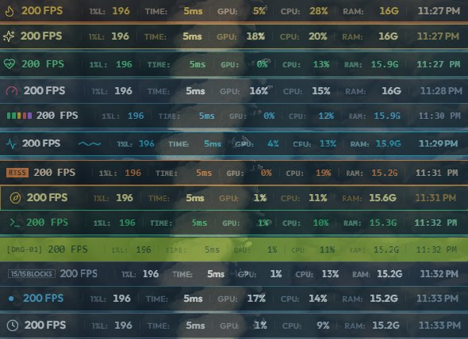
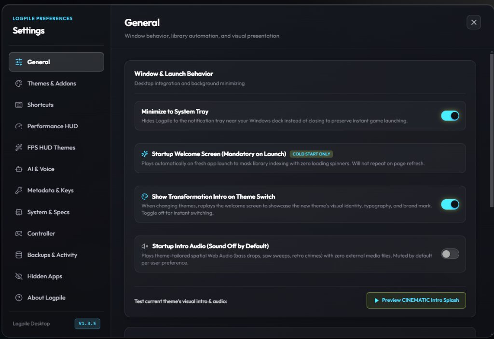
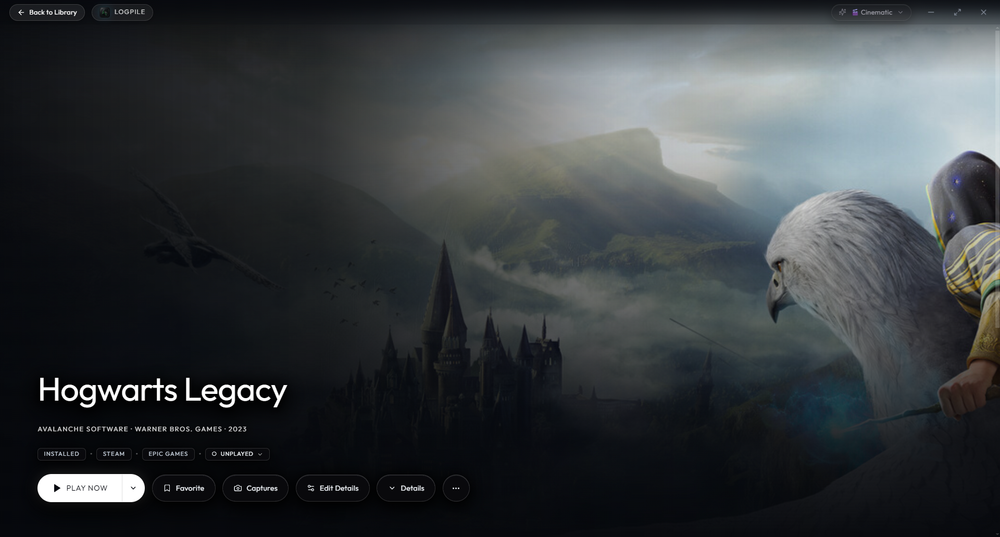
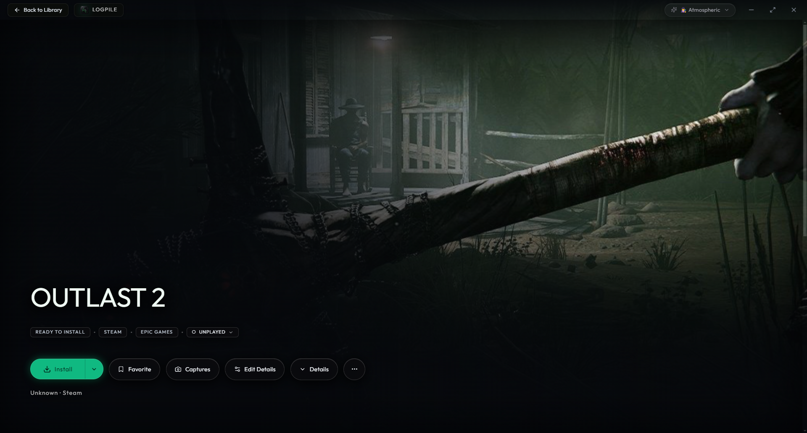

# Logpile — Best Free Offline PC Game Launcher & Library Manager (Playnite Alternative)
> **The lightweight, open-source PC game launcher, library manager, and game saver for Windows. Built as an offline alternative to Playnite and GOG Galaxy. Unify games across Steam, Epic, GOG, and portable SSDs with automatic save backups, HowLongToBeat backlog tracking, 50+ custom HUD overlays, and zero cloud tracking.**

[](../../releases/latest)
[](../../releases/latest)
[](LICENSE)
[](#)
[](https://logpilegamelauncher.netlify.app)
[](https://logpile.itch.io/logpile)
[](https://alternativeto.net/software/logpile-desktop/about/)

<p align="center">
  <a href="https://github.com/ritesh-soni-logpile/logpile/releases/download/v1.3.95/Logpile.Setup.1.3.95.exe">
    
  </a>
  &nbsp;&nbsp;
  <a href="https://github.com/ritesh-soni-logpile/logpile/releases/download/v1.3.95/Logpile-1.3.95-win.zip">
    
  </a>
</p>

<!-- Hero Demonstration -->
<p align="center">
  
</p>

## Why Gamers Choose Logpile (Playnite & GOG Galaxy Alternative)
Most PC game launchers and library managers are storefronts first. They run heavy web browsers in the background, demand account logins just to view games on your own drives, and break when Windows shifts an external SSD from `D:` to `E:`. They also leave you guessing whether a shared Steam Family title is actually free to play before you launch it.

Logpile is built for gamers who want the best offline PC game launcher, library manager, and game saver:
- **Playnite & GOG Galaxy Alternative:** Discovers and launches your games directly from disk without store logins, third-party sync plugins, or memory bloat.
- **Automated Game Saver:** Automatically monitors local game save folders and creates rolling timestamped ZIP backups before every session.
- **Portable SSD Path Healing:** Uses `{{PORTABLE_ROOT}}` variables to self-heal broken game paths when drive letters change.
- **50+ Themed Performance HUDs:** Custom in-game FPS and hardware telemetry overlays that pull 0.0% idle GPU power when minimized.
- **HowLongToBeat Backlog Tracker:** Built-in Excel and CSV backlog import with campaign debt calculation.
- **100% Offline & Private:** Open-source MIT license, zero network telemetry, and zero background services.

---

## At a Glance: Feature Comparison


| Feature | Logpile v1.3.95 | Steam | Playnite | GOG Galaxy | LaunchBox |
| :--- | :--- | :--- | :--- | :--- | :--- |
| **Local Game Detection** | **Zero logins:** Scans drives & folders directly | Store account login required | Account logins required for library sync | GOG account login required | Account logins or store tokens required |
| **Bulk Backlog Import** | **Built-in:** Import entire uninstalled library via Excel / CSV | No (Single manual shortcut only) | Plugin required | No | Plugin required |
| **Portable Drive Path Healing** | **Built-in:** Auto-adapts when drive letters change (`D:` to `E:`) | Breaks on drive letter change | Breaks on drive letter change | Breaks on drive letter change | Breaks on drive letter change |
| **Live Steam Family Status** | **Yes:** Checks if shared game is free to play before launch | In-app store client only | No live check | No live check | No live check |
| **Automated Save Backups** | **Built-in:** Automatic rolling local ZIP archives | Cloud only (for supported games) | Plugin required (e.g. Ludusavi) | Cloud only (for supported games) | Plugin required |
| **Offline Strategy Guides** | **Built-in:** Offline guide, map & tip viewer | Community web browser tabs only | External browser links only | External browser links only | External browser links only |
| **Themed Performance HUD** | **50+ Custom Styles:** Themed in-game overlays (0% idle GPU) | Basic plain text FPS counter | Third-party tools needed (RTSS) | Basic plain text FPS counter | Third-party tools needed |
| **Theme Studio & Custom CSS** | **Built-in:** Live CSS injector, natural language synthesis, 8 community themes | No | Third-party skin plugins | No | Themes via community themes |
| **Full Page & 4K Brag Snaps** | **Built-in:** Continuous vertical settings capture & 4K UHD gallery posters | Basic desktop screenshot | Screenshot plugins | Basic screenshot | Basic screenshot |
| **Big Picture Console Mode** | **5 Theme Worlds:** Distinct 10-foot UIs, Couch OSK, Adaptive Glyphs & Voice AI | One fixed layout | Fullscreen mode (theme-dependent) | No | Paid Big Box mode |
| **Controller Auto-Detect** | **Yes:** Instant Windows plug-and-play detection | Big Picture mode or manual setup | Wake-up button press required | Manual setup / limited | Wake-up button press required |
| **Privacy & Offline First** | **100% Offline:** MIT open source, zero logins, zero tracking | Closed source, store accounts & tracking | Open source, relies on store logins | Closed source, accounts & telemetry | Closed source, logins for metadata |

---

## What's New in v1.3.95

### Universal PC Storefront & Custom Folder Scanning
- **20+ Supported PC Platforms & Launchers:** Automatic local detection across **Steam**, **Epic Games**, **GOG**, **Xbox / Microsoft Store**, **EA App / Origin**, **Ubisoft Connect**, **Amazon Games**, **itch.io** (`butler.db`), **Battle.net**, **Riot Games**, **Rockstar Games Launcher**, **CD Projekt REDlauncher**, **Netmarble**, **NetEase**, **Legacy Games**, **HoYoPlay (HoYoverse)**, **Humble App**, **Wargaming Game Center**, **Gaijin**, **Nexon**, **Kuro Games**, **Roblox**, and standalone MMO/repack clients.
- **Custom Game Scan Folders:** Add custom library directories (such as `D:\Games` or portable SSD game folders) in **Settings** to automatically detect DRM-free, portable, and standalone titles without adding games one by one.
- **Multi-Store Linking, Icons & Launch Support:** Distinct storefront icons, platform badges, launch argument persistence (for Riot Client & custom launchers), Excel/CSV auto-labeling, and background launcher process protection during playtime tracking.
- **Cross-Store Deduplication & Duplicate Install Advisor:** Unified matching across editions and naming styles (e.g., *GTA V* / *Grand Theft Auto V Legacy* / *Enhanced* / *Premium Edition*, Roman numerals, abbreviations) plus a **Duplicate Installs & Storage Saver** panel in the Dashboard and Game Dossier that highlights games installed on 2+ storefronts, recommends which copy to keep, and shows reclaimable GB with quick Uninstall / Open Folder controls.
- *Coming in v1.4.0:* Retro / ROM Emulator library support.

---

## What's New in v1.3.9

### 1. Big Picture Console Mode: 5 Distinct Theme Worlds
Press `F11`, `Ctrl+Shift+F`, or click **Console Mode** in the top bar to switch into a 10-foot couch and handheld interface. Every built-in theme swaps to its own dedicated layout and its own **Today's Pick** mechanic:
- **Cinematic:** Full-bleed IMAX screening room hero with lower-left gold marquee, bottom title counter, and a centered Today's Pick card with an internal `16:9` reel.
- **Playful:** 3-slot wrap-around `16:9` landscape tile carousel over a dotted charcoal canvas with unobstructed artwork and a floating Surprise Capsule for Daily Pick.
- **Atmospheric:** Survival-horror save-room view with `16:9` landscape artwork behind drifting mist, a 5-row sliding vertical Case Ledger (`Up`/`Down`), right-side case details, and an Analog Signal Receiver + `16:9` Signal Monitor for Daily Pick.
- **Kinetic:** Dark asphalt motorsport HUD featuring a `-8deg` diagonal artwork split, speed-streak transitions, a 3-cell telemetry strip (`HRS_LOGGED`, `EST_RUN`, `DRIVE_STATE`), bounded 5-slot slanted Track Strip, and a 5-light Starting-Grid Gantry for Daily Pick.
- **Competitive:** 3-zone tactical match lobby with a 6-row left Roster Queue (storefront tags and status LEDs), corner-reticle showcase framing, bottom-right `DEPLOY NOW` / `QUEUE INSTALL` panel, and a Matchmaking Queue Scanner (`MATCH FOUND`) for Daily Pick.

### 2. Full Controller Navigation & Hardware-Adaptive Glyphs
- **End-to-End Gamepad Control:** Navigate the Desktop library, Sanctuary Spotlight, sidebar, top bar, Settings modal, and Game Dossier screens by controller, with wrap-around list stepping in Console Mode and `LT`/`RT` trigger support.
- **Auto-Detected Controller Prompts:** Automatically displays **Xbox**, **PlayStation** (`✕`, `○`, `▢`, `△`, `L1`/`R1`/`L2`/`R2`), or **Nintendo Switch** glyphs based on your connected gamepad, with manual override in Settings.
- **Uninstalled Title Triggers:** In Console Mode, `(A)` and primary action triggers route uninstalled titles directly through `installUri` (`DOWNLOAD NOW`, `DOWNLOAD`, `RETRIEVE`, `PIT INSTALL`, `QUEUE INSTALL`).
- **Multimodal Input:** Switch freely between controller, mouse, keyboard, and touch at any time.

### 3. Console Telemetry Ribbon & On-Screen Couch Keyboard
- **Top Telemetry Ribbon:** Displays category tabs (`Installed`, `Favorites`, `All Games`, `Today's Pick` / `Daily Pick`, `Search`, `AI Assistant`) via `LB`/`RB` or click, active search filter pill with one-click clear, connected controller/PC indicator, smart laptop/handheld battery readout (hidden on AC desktop PCs), 12-hour clock, Settings shortcut (`Start`), and **Return to Desktop**.
- **On-Screen Virtual Keyboard (OSK):** Search games using D-pad, mouse, or touch with live match counts, one-click clear, and simultaneous physical keyboard input.

### 4. Voice-First Console AI Companion & Privacy Controls
- **Push-to-Talk & Spoken Replies:** In Console Mode, press `[R3]` (or click the Voice orb) to dictate prompts, stream recognized speech into chat, hear TTS replies, navigate quick chips with the D-pad, or open the On-Screen Keyboard across theme-matched HUDs.
- **Enable Local Gaming AI Toggle:** Hide all AI Companion tabs and buttons cleanly across Desktop and Console modes when disabled.

### 5. Optional Console Audio, Escape Controls & Desktop Fixes
- **Tactile Controller Navigation Audio:** Zero-file Web Audio synthesized navigation ticks, confirm chimes, and back clicks (muted by default; configurable in Settings).
- **Allow Escape Key to Exit Console Mode Toggle:** Configurable in Settings (off by default so `Esc` acts as Back inside menus and search).
- **Desktop Today's Pick & Dossier Polish:** Restored the side-by-side 2-column Today's Pick layout across all 5 Desktop themes without vertical scrolling, aligned action buttons cleanly, and normalized Game Dossier card styling.

---

## What's New in v1.3.7

### 1. Live Custom CSS Theme Studio & Synthesizer
Fine-tune your sanctuary aesthetics down to the exact CSS selector. Features a real-time `<style>` injector, a natural-language theme synthesizer with instant 0ms offline keyword fallback, 8 inspiration presets (Gothic Obsidian, Cyber 2077, Nordic Frost, Synthwave Outrun, Emerald Temple, OLED Noir, Imperial Gold, Matrix Operator), monospace live editor, and 1-click `.css` file import and export.

### 2. 8 Bundled Community Themes
Eight production-grade community themes ready to activate in one click:
- **Cyberpunk 2077:** Night City canary yellow, high-tech cyan, and dark carbon cards.
- **8-Bit Game Boy:** 1989 dot-matrix spinach LCD green with retro arcade framing.
- **Matrix Digital Rain:** Terminal phosphor green over pitch-black OLED background.
- **Nord Arctic Frost:** Arctic deep slate and frosted polar blue styling.
- **Pure OLED Stealth:** True #000000 pitch-black cards with razor-sharp white accents.
- **Pip-Boy 3000 Terminal:** Fallout wasteland amber and green scanline styling.
- **Steam 2004 Nostalgia:** Half-Life 2 launch valve olive khaki and brushed steel.
- **Synthwave 80s:** Outrun hot neon magenta and cyan grid aesthetic.

### 3. Continuous Full-Page Settings Snapshot
Capture the entire scrollable Settings modal from top to bottom into a single high-resolution vertical PNG. Programmatically scrolls and stitches cards with 1:1 native pixel alignment, zero horizontal seams, zero drop-shadow bleed, and preserves the full left sidebar navigation (all 12 tabs and version tag) with automatic clipboard copy.

### 4. 4K Ultra-Wide Brag Showcase Collage Engine
Export your game sanctuary into balanced 4K widescreen gallery posters (3840 × 6172). Features multi-line title wrapping to prevent name cutoffs, dynamic 10–14 column scaling, high-DPI aspect-fill poster rendering, and full theme-variable color resolution across all 5 core sanctuary themes (Cinematic, Atmospheric, Competitive, Kinetic, Playful) and 7 accent palettes.

### 5. In-Game Performance HUD & Telemetry Polish
Real-time Intel PresentMon graphics telemetry overlay with true 1% lows, frame times, CPU-bound bottleneck indicators (`CPU-LIM`), and full GPU/CPU thermal and clock monitoring across DirectX 11/12 and Vulkan titles with 0% idle desktop GPU draw.

### 6. Modern Setup & In-Place Upgrade Experience
Upgrading or installing Logpile is effortless: the custom setup wizard automatically detects existing installations, upgrading binaries in-place while keeping your game saves, library databases, and artwork caches 100% intact. Supports any custom internal drive or external SSD path without registry lock-in.

---

## What's New in v1.3.5

### 1. Themed In-Game Performance HUDs
Most performance overlays give you generic green numbers or force you to install third-party software like RivaTuner. Logpile includes over 50 custom HUD overlay styles that match what you're playing—including MI6 007 Covert, Cyberpunk Netrunner, Witcher Wolf, Doom, GameBoy 8-Bit, and retro Winamp 1999.

<p align="center">
  
</p>

### 2. Custom HUD Theme Studio
Build, modify, and save custom in-game performance HUDs directly inside the launcher. You can dial in themes manually or generate them from aesthetic prompts using local models or offline presets. Unmatched searches automatically fall back to clean neutral slate designs without breaking.

<p align="center">
  
</p>

### 3. Zero Desktop Idle GPU Drain & Hardware Guard
Running modern launchers on laptops or gaming handhelds often drains battery life due to constant desktop animation loops. Logpile completely kills background animation loops while sitting idle or minimized, pulling 0% idle GPU power. You can also configure dynamic VRAM caps and automatically purge AI models from RAM the moment a game launches.

<p align="center">
  
</p>

### 4. Automatic Theme Transformation Splash
Switching themes now greets you with that theme's visual branding, spatial Web Audio, and logo animation. A single toggle in General Preferences lets you choose between cinematic transformations or instant theme switching.

<p align="center">
  
</p>

### 5. Customizable Global Shortcuts
Assign your own key combinations for library search, the in-game overlay, and the performance HUD toggle with built-in Excel conflict safety.

<p align="center">
  
</p>

---

## Visual Showcase & Architecture

### Dynamic Game Dossier Themes
Adapts visually per game with 5 hardware-accelerated aesthetic profiles: Cinematic, Atmospheric, Competitive, Kinetic, and Playful.

<p align="center">
  
  
</p>
<p align="center">
  
  
</p>

### Backlog Intelligence & Sanctuary Analytics
Tracks your true gaming journey: backlog campaign debt (HLTB synced), source distribution, playtime curves, and local strategy guide indexing.

<p align="center">
  
</p>

---

## Architecture & Tech Stack
- **Shell:** Electron 34 with strict `contextIsolation: true`, zero raw IPC leaks, and sandbox-isolated window navigation.
- **Frontend:** React 18, Vite, Tailwind CSS, virtualized catalog grid, and native 60fps Gamepad API polling that auto-pauses during gameplay.
- **In-Game Telemetry:** Integrated Intel PresentMon (MIT License) for real-time DirectX 11/12 and Vulkan frame time velocity, true 1% lows, GPU/VRAM load, and hardware engine bottleneck detection without game DLL injection.
- **Local Database:** SQLite with FTS5 full-text indexing via `better-sqlite3`.
- **Offline Intelligence:** Embedded `node-llama-cpp` for local quantized GGUF inference + offline speech recognition (STT) and Windows native SAPI (TTS).

---

## Quickstart

### For Gamers
1. Grab the latest installer or portable archive from [Releases](../../releases/latest):
   - **Installer:** [`Logpile.Setup.1.3.95.exe`](https://github.com/ritesh-soni-logpile/logpile/releases/download/v1.3.95/Logpile.Setup.1.3.95.exe)
   - **Portable (.zip):** [`Logpile-1.3.95-win.zip`](https://github.com/ritesh-soni-logpile/logpile/releases/download/v1.3.95/Logpile-1.3.95-win.zip)
2. Extract or install to any internal drive or portable SSD (`logpile_data/` stores all assets self-contained).
3. *(Optional)* Drop any quantized `.gguf` model into the `/models` directory to enable offline conversational backlog guidance.

#### Recommended Offline AI Models (Optional)
To enable offline natural-language backlog search and theme suggestions, place any compatible quantized `.gguf` model into your local `/models` directory:

---

## Recommended Local Models (GGUF)

Logpile runs local GGUF models via `node-llama-cpp` for conversational backlog guidance, custom HUD/CSS theme synthesis, and offline chat. Download any `.gguf` file and drop it into your `/models` folder.

The picks below are abliterated/uncensored builds so mature game titles, horror themes, and lore don't trigger false refusals. Every repo works on both CPU and GPU systems. Pick the quantization file (`Q4_K_M`, `Q6_K`, `Q8_0`, etc.) that matches your hardware while leaving 1 to 1.5 GB free for Windows and context cache.

| System / VRAM | Best Pick | Quant File | Approx. Size |
| :--- | :--- | :--- | :--- |
| **CPU Only (8-16 GB RAM)** | [Qwen3.5-2B EmperoAI Distill](https://huggingface.co/mradermacher/Qwen3.5-2B-EmperoAI-Qwen3.8-Distill-Heretic-Abliterated-i1-GGUF) | `Q4_K_M` or `Q5_K_M` | 1.1 - 1.4 GB |
| **CPU Only (32 GB+ RAM)** | [Qwen3.5-4B EmperoAI Distill](https://huggingface.co/mradermacher/Qwen3.5-4B-EmperoAI-Qwen3.8-Distill-Heretic-Abliterated-i1-GGUF) | `Q4_K_M` | ~2.7 GB |
| **4 GB VRAM** | [Qwen3.5-4B EmperoAI Distill](https://huggingface.co/mradermacher/Qwen3.5-4B-EmperoAI-Qwen3.8-Distill-Heretic-Abliterated-i1-GGUF) | `IQ4_XS` or `Q4_K_M` | 2.5 - 2.7 GB |
| **6 GB VRAM** | [Qwen3.5-4B EmperoAI Distill](https://huggingface.co/mradermacher/Qwen3.5-4B-EmperoAI-Qwen3.8-Distill-Heretic-Abliterated-i1-GGUF) | `Q6_K` or `Q8_0` | 3.5 - 4.5 GB |
| **8 GB VRAM** | [Qwen3.5-9B Heretic v2](https://huggingface.co/mradermacher/Qwen3.5-9B-heretic-v2-i1-GGUF) | `Q4_K_M` | ~5.5 GB |
| **12 GB VRAM** | [Qwen3.5-9B Heretic v2](https://huggingface.co/mradermacher/Qwen3.5-9B-heretic-v2-i1-GGUF) | `Q6_K` or `Q8_0` | 7.5 - 9.5 GB |
| **16 - 32 GB VRAM** | [Qwen3.5-9B Heretic v2](https://huggingface.co/mradermacher/Qwen3.5-9B-heretic-v2-i1-GGUF) | `Q8_0` or `F16` | 9.5 - 18 GB |

> **Hardware Guard Tip:** Enable automatic AI memory purge in Settings to clear loaded models from RAM/VRAM the moment a game launches. If you prefer keeping the AI loaded while playing, stick to a 2B or 4B model with a VRAM cap.

<details>
<summary><strong>More Compatible Models (1.5B to 9B)</strong></summary>

#### 1.5B - 2B (Ultra-Fast / Low RAM)
- [Qwen3.5-2B Heretic GGUF](https://huggingface.co/tvall43/Qwen3.5-2B-heretic-gguf) (Clean base 2B)
- [Qwen2.5-1.5B Instruct Heretic](https://huggingface.co/saidutta69/Qwen2.5-1.5B-Instruct-heretic) (Smallest footprint)

#### 3B - 4B (Fast & Balanced)
- [Gemma-4-E4B-it Heretic GGUF](https://huggingface.co/igorls/gemma-4-E4B-it-heretic-GGUF) (Natural writing style; supports vision with `mmproj`)
- [Qwen3-4B Thinking Claude-4.5-Opus Distill](https://huggingface.co/mradermacher/Qwen3-4B-Thinking-2507-Claude-4.5-Opus-High-Reasoning-Distill-Heretic-Abliterated-i1-GGUF) (Reasoning/thinking distill)
- [Llama-3.2-3B Instruct Heretic](https://huggingface.co/DavidAU/Llama-3.2-3B-Instruct-heretic-ablitered-uncensored) (Lightweight non-thinking fallback)

#### 7B - 8B (Strong General & Reasoning)
- [Qwen3-8B Hivemind Instruct Heretic](https://huggingface.co/DavidAU/Qwen3-8B-Hivemind-Instruct-Heretic-Abliterated-Uncensored-NEO-Imatrix-GGUF) (General instruct)
- [DeepSeek-R1-0528 Qwen3-8B Heretic](https://huggingface.co/richardyoung/DeepSeek-R1-0528-Qwen3-8B-heretic-GGUF) (Pure reasoning distill)
- [Meta-Llama-3.1-8B Instruct Heretic](https://huggingface.co/saidutta69/Meta-Llama-3.1-8B-Instruct-heretic) (Classic Llama formatting)

#### 9B (Max Quality for 8 GB+ VRAM)
- [DeepSeek-V4-Pro Qwen3.5-9B Heretic](https://huggingface.co/mradermacher/DeepSeek-V4-Pro-Qwen3.5-9B-UNCENSORED-heretic-i1-GGUF) (High-end distilled reasoning)
- [Qwen3.5-9B The Defiant Fable Heretic](https://huggingface.co/DavidAU/Qwen3.5-9B-The-Defiant-Fable-Uncensored-Heretic-NEO-IMATRIX-MAX-MTP-GGUF) (Creative/descriptive text)

</details>

*Note: Logpile is an independent open-source project and is not affiliated with, endorsed by, or sponsored by Hugging Face or any of the model creators listed above. All models are third-party community suggestions and remain subject to their respective licenses.*

### For Developers
```bash
git clone https://github.com/ritesh-soni-logpile/logpile.git
cd logpile
npm install
npm run electron:dev
```

---

## Author & License

Logpile is designed, architected, and tested by **Corporate Introvert Gamer (Ritesh Soni)**.

This project is licensed under the [MIT License](LICENSE).

```
Copyright (c) 2026 Corporate Introvert Gamer (Ritesh Soni)
```

### Third-Party Software & Acknowledgments
- **Intel PresentMon:** In-game graphics telemetry powered by Intel PresentMon (MIT License). Copyright (c) Intel Corporation.
- **HWiNFO:** Hardware sensor telemetry via HWiNFO's Shared Memory Support (when enabled by the user in HWiNFO).
