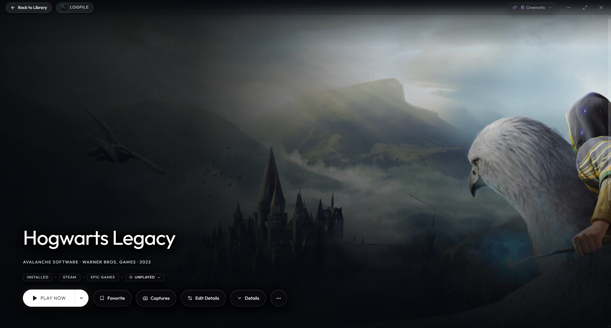
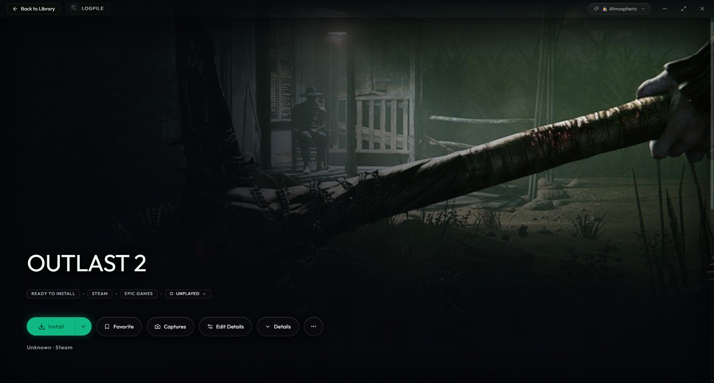
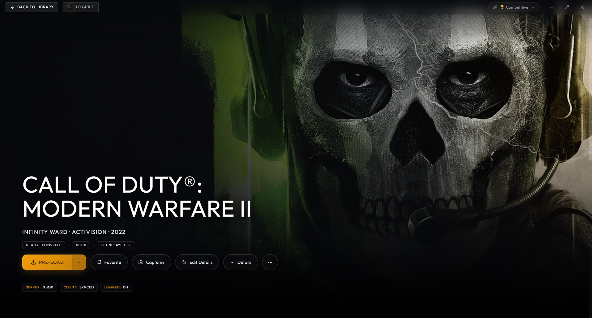
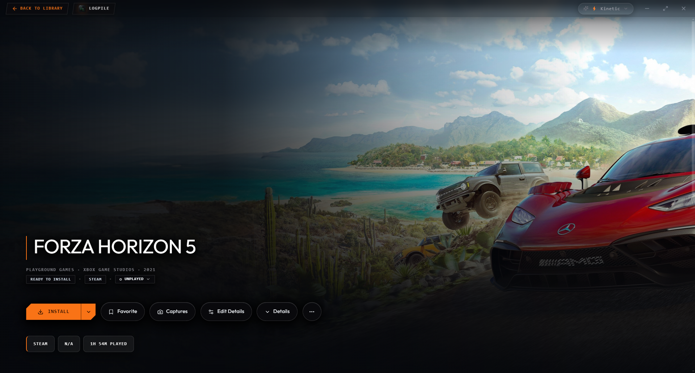

# Logpile
> **An offline-first, zero-bloat PC game library manager. Built for portable drives, powered by local AI, and completely disconnected from the cloud.**

[](../../releases/latest)
[](../../releases/latest)
[](LICENSE)
[](#)

<p align="center">
  <a href="https://github.com/ritesh-soni-logpile/logpile/releases/download/v1.3.1/Logpile.Setup.1.3.1.exe">
    
  </a>
  &nbsp;&nbsp;
  <a href="https://github.com/ritesh-soni-logpile/logpile/releases/download/v1.3.1/Logpile-v1.3.1-Portable.zip">
    
  </a>
</p>

<!-- Hero Demonstration -->
<p align="center">
  
</p>

## Why Logpile?
Traditional game launchers break on portable SSDs when drive letters change, lock saves behind cloud subscriptions, and run heavy background chromium engines that steal CPU cycles and VRAM while gaming. They also leave you guessing whether a shared Steam Family game is actually free to play before you launch it.

Logpile stores everything—databases, artwork, and save backups—inside a single portable directory. It self-heals broken Windows drive letters automatically, detects live Steam Family availability status directly from your local library, protects frame rates with an active RAM guard, and indexes strategy guides locally so you never have to Alt-Tab for help.

---

## At a Glance: Feature Comparison

| Capability | Logpile v1.3.1 | Playnite | LaunchBox |
| :--- | :--- | :--- | :--- |
| **Storefront Auto-Detection** | **8 Native Sources** (Steam, Epic, GOG, Xbox, EA, Ubisoft, Amazon, Standalone) + automatic DLC/Utility filtering | Requires 3rd-party community plugins that break on API updates | Limited native store sync |
| **Steam Family Sharing Status** | **Yes (Exclusive)** Detects live playing & availability status of shared family titles before launch | No (Library detection only; no in-use/active player status) | No |
| **Portable Drive Self-Healing** | **Yes (`{{PORTABLE_ROOT}}`)** Auto-resolves drive-letter shifts across different PCs | No (Absolute paths break on letter change) | Partial |
| **Save Sync & Conflict Guard** | **Yes** (Automated 3-tier rolling zip backup + pre-launch restore prompt on new PCs) | Requires community plugin (Ludusavi) | No native tool |
| **In-Game Companion & Guides** | **Yes** (Fast Guide with near-zero memory footprint + Local Offline AI RAG via SQLite FTS5) | No | Manual PDF viewer only |
| **Active RAM Protection** | **Yes** (Auto-unloads GGUF model from RAM on game spawn + Pre-Launch RAM Guard) | No (Extensions remain resident) | Heavy .NET runtime overhead |
| **Backlog Recovery System** | **Yes** (Post-game checkpoint notes + 14-day idle refresher cards with combat cheat-sheets) | Basic status tags only | Static text notes |
| **Voice & Gamepad Control** | **Yes** (Gamepad R3 Push-to-Talk, optional "Hey Logpile" wake word + 60fps controller grid) | Requires controller addon | Separate Big Box paid license |
| **Retro / ROM Emulation** | Planned for v1.4.0 | Extensive | Extensive |

---

## Visual Showcase & Architecture

### 1. Dynamic Game Dossier Themes
Adapts visually per game with 5 hardware-accelerated aesthetic profiles: Cinematic, Atmospheric, Competitive, Kinetic, and Playful.

<p align="center">
  
  
</p>
<p align="center">
  
  
</p>

### 2. Backlog Intelligence & Sanctuary Analytics
Tracks your true gaming journey: backlog campaign debt (HLTB synced), source distribution, playtime curves, and local strategy guide indexing.

<p align="center">
  
</p>

### 3. Dual-Engine In-Game Overlay (`Ctrl+Space`)
- **Fast Guide Mode:** Near-zero memory footprint with zero game lag to access offline strategy guides and video walkthroughs without Alt-Tab.
- **Gaming AI Mode:** Local CPU quantized inference answering questions with context-aware game suggestions.

<p align="center">
  
</p>

### 4. Zero-Bloat Settings & Hardware Optimization
Configure 1440p hero backdrops, toggle the offline engine with automatic 30-second RAM unloading, and manage high-speed asset sync.

<p align="center">
  
</p>

---

## Architecture & Tech Stack
- **Shell:** Electron 34 with strict `contextIsolation: true`, zero raw IPC leaks, and sandbox-isolated window navigation.
- **Frontend:** React 18, Vite, Tailwind CSS, virtualized catalog grid, and native 60fps Gamepad API polling that auto-pauses during gameplay.
- **Local Database:** SQLite with FTS5 full-text indexing via `better-sqlite3`.
- **Offline Intelligence:** Embedded `node-llama-cpp` for local quantized GGUF inference + offline speech recognition (STT) and Windows native SAPI (TTS).

---

## Quickstart

### For Gamers
1. Grab the latest installer or portable archive from [Releases](../../releases/latest):
   - **Installer:** [`Logpile.Setup.1.3.1.exe`](https://github.com/ritesh-soni-logpile/logpile/releases/download/v1.3.1/Logpile.Setup.1.3.1.exe) (166 MB)
   - **Portable (.zip):** [`Logpile-v1.3.1-Portable.zip`](https://github.com/ritesh-soni-logpile/logpile/releases/download/v1.3.1/Logpile-v1.3.1-Portable.zip) (210 MB)
2. Extract or install to any internal drive or portable SSD (`logpile_data/` stores all assets self-contained).
3. *(Optional)* Drop any quantized `.gguf` model into the `/models` directory to enable conversational backlog guidance.

### For Developers
```bash
git clone https://github.com/ritesh-soni-logpile/logpile.git
cd logpile
npm install
npm run electron:dev
```

---

## Author & License

Logpile is designed, maintained, and tested by **Corporate Introvert Gamer (Ritesh Soni)**.

This project is licensed under the [MIT License](LICENSE).

```
Copyright (c) 2026 Corporate Introvert Gamer (Ritesh Soni)
```
